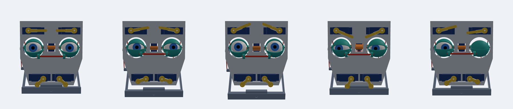
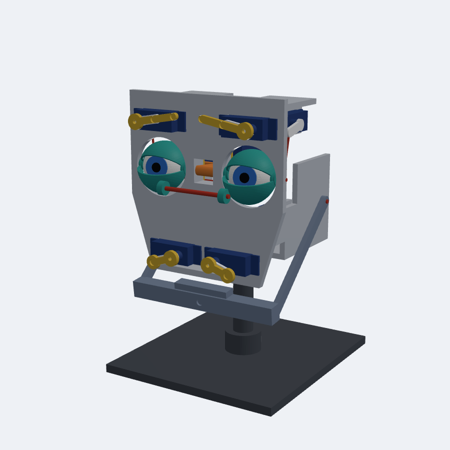
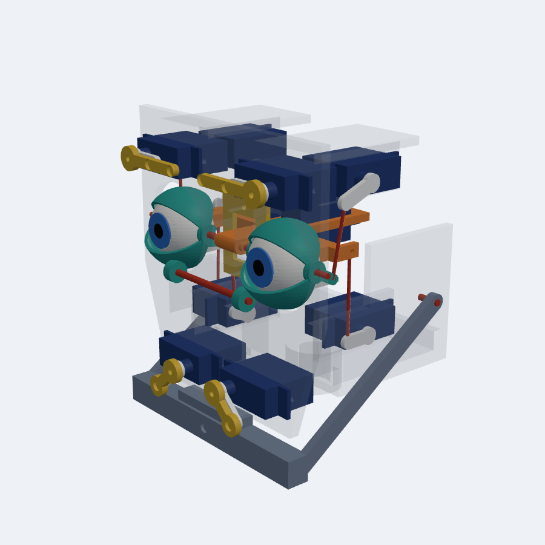
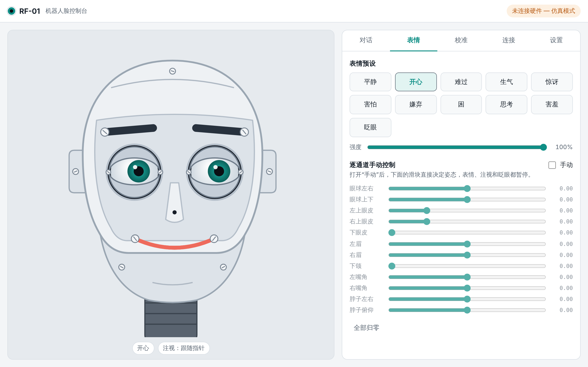

# RF-01 仿生机器人脸

一张可以自己打印、自己装的桌面机器人脸：眼球会转、会眨眼、有眉毛和嘴角表情、下颌随说话开合，由大模型对话驱动。

本目录是一套**独立设计的 v0.1**，包含机械 CAD、下位机固件和浏览器控制台三部分。它与仓库根目录的 Internal Beyond 网页项目互不依赖，也没有改动那边的任何文件。



## 现在是什么状态

先说清楚哪些验证过、哪些没有，免得你按图打印后才发现问题。

| 部分 | 已验证 | 未验证 |
|---|---|---|
| 机械 CAD | 16 种打印件都是单个有效实体；9 个极限姿态下零件、舵机、舵盘、连杆之间零干涉；5 组连杆在全行程有解，最差传动角 37°；关键装配步骤的移动路径无碰撞 | **没有实际打印和装配过**。舵机外形尺寸是常见规格，不是实测值 |
| 浏览器控制台 | 32 项单元测试、60 项无头浏览器检查通过（表情、对话解析、串口帧、手机布局） | 真实串口、麦克风、摄像头、真实大模型接口都没有接过 |
| 固件 | 协议核心 394 项检查通过，含主机端生成的帧 | **没有为 ESP32 真正编译过**（本环境下载不了工具链），只做了语法检查 |

所以这是一份可以开工的初版，第一次打印后一定需要改尺寸。改法见 [docs/BUILD.md](docs/BUILD.md)。

## 设计概览



- **尺寸**：骨架宽 80 mm、高 86 mm、深 57 mm，约为真人脸的一半多一点。眼球 Ø20，瞳距 46。
- **自由度**：10 个 3.7 g 微型舵机。

| 通道 | 舵机 | 传动方式 | 行程 |
|---|---|---|---|
| 眼球左右 | 1 | 舵机装在眼球支架上，平行四边形拉杆带动两眼 | ±25° |
| 眼球上下 | 1 | 推杆带动整个眼球支架俯仰 | ±15° |
| 上眼皮 | 2 | 左右独立，推杆。可单眼眨 | 睁大 15° 到闭合 71° |
| 下眼皮 | 1 | 推杆带右侧，一根钢丝连桥带左侧 | 0–25° |
| 眉毛 | 2 | 直驱，摆臂外端为轴 | ±22° |
| 嘴角 | 2 | 直驱 | ±25° |
| 下颌 | 1 | 推杆，约 4:1 减速 | 0–11° |

- **皮肤接口**：眉毛摆臂、嘴角垫片、下巴上留了 7 个 Ø3 磁铁孔，硅胶皮肤用磁铁吸附。皮肤本身和模具不在 v0.1 里，做法见 [docs/SKIN.md](docs/SKIN.md)。
- **还没有的**：脖子（通道 10、11 已预留，现在是固定支座）、后脑壳、皮肤模具。



## 目录

```
spec/rig.json        12 个通道的定义和默认校准值（三部分共用）
docs/PROTOCOL.md     串口协议
docs/BUILD.md        物料、打印、装配、接线、首次上电
docs/SKIN.md         硅胶皮肤的做法
docs/REFERENCES.md   参考的开源项目和各自的许可
cad/                 参数化 CAD（CadQuery）和导出的 STL / STEP
firmware/            ESP32 + PCA9685 固件（PlatformIO）
app/                 浏览器控制台和仿真器
```

## 不用硬件先玩起来

用 Chrome 或 Edge 直接打开 `app/face.html`，不需要安装任何东西。



- **表情**页：11 个表情预设，也可以打开“手动”逐通道拖滑块。
- **对话**页：在**设置**页填好接口后可以聊天。回复里的表情标签（如 `[happy]`）会驱动表情，文字会被念出来并带动嘴巴。
- 眼睛默认跟随鼠标。打开摄像头后可以跟随人脸，或者镜像你的表情。
- 没连硬件时一切都在仿真器里运行。画面是由“姿态 → 脉宽 → 姿态”反推出来的，校准填错了会直接在画面上看出来。

### 接大模型

设置页支持两种接口：

- **Anthropic 原生**：默认模型 `claude-opus-5-5`，为了对话跟手用了低思考强度。直连 `api.anthropic.com` 时会自动启用官方的拒答回退；用中转站时不会发送这个参数。
- **OpenAI 兼容**：用于中转站、DeepSeek 等。

API Key 只保存在本机浏览器的 localStorage 里。

## 做一台真的

按 [docs/BUILD.md](docs/BUILD.md) 的顺序来。建议分三步，每一步都能独立看到效果：

1. **只装眼睛**：前板、眼球支架、眼皮和 5 个舵机。能转眼、眨眼、跟随人脸。
2. **加眉毛、嘴角、下颌**：能做表情、对口型。
3. **加皮肤**。

## 重新生成 CAD

```bash
pip install cadquery
cd cad && python3 build.py        # 约 45 秒，输出到 cad/out/
python3 check_assembly.py         # 检查装配步骤的移动路径
```

所有尺寸都在 `cad/rf01/params.py`。`build.py` 会重新导出全部零件、重算连杆行程，并跑一遍干涉检查，有干涉时以非零状态退出。

## 运行测试

```bash
node --test app/tests/            # 控制台核心逻辑
node app/tests/smoke.mjs          # 无头浏览器冒烟测试（需要 Playwright）
bash firmware/test/run.sh         # 固件协议核心（需要 g++）
```

## 许可

本目录的设计和代码是独立完成的，没有复制任何第三方 CAD 文件或源码；参考过的开源项目和它们的许可列在 [docs/REFERENCES.md](docs/REFERENCES.md)。本目录随仓库根目录的 LICENSE 发布。
